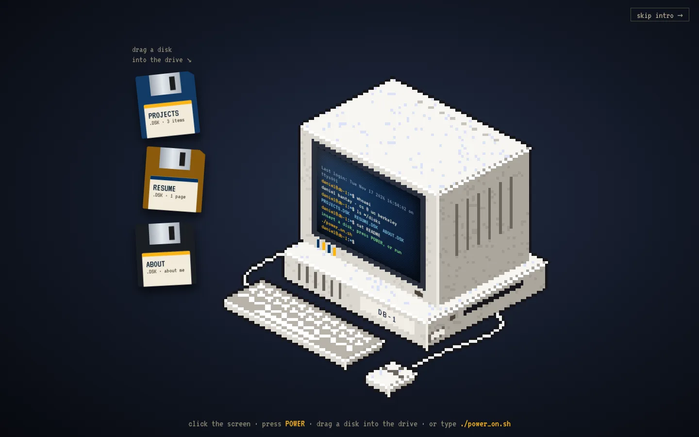
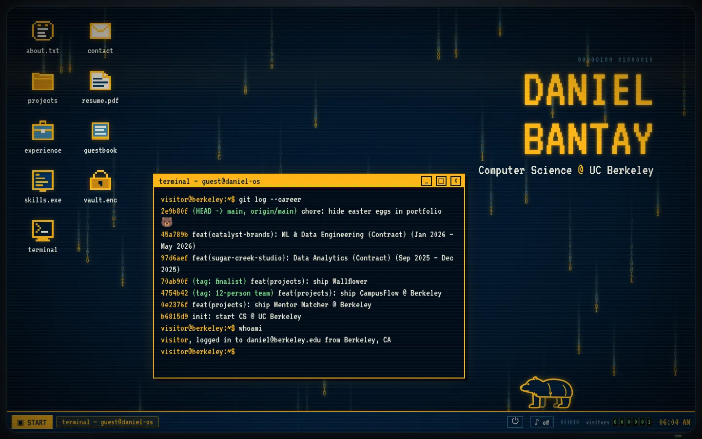
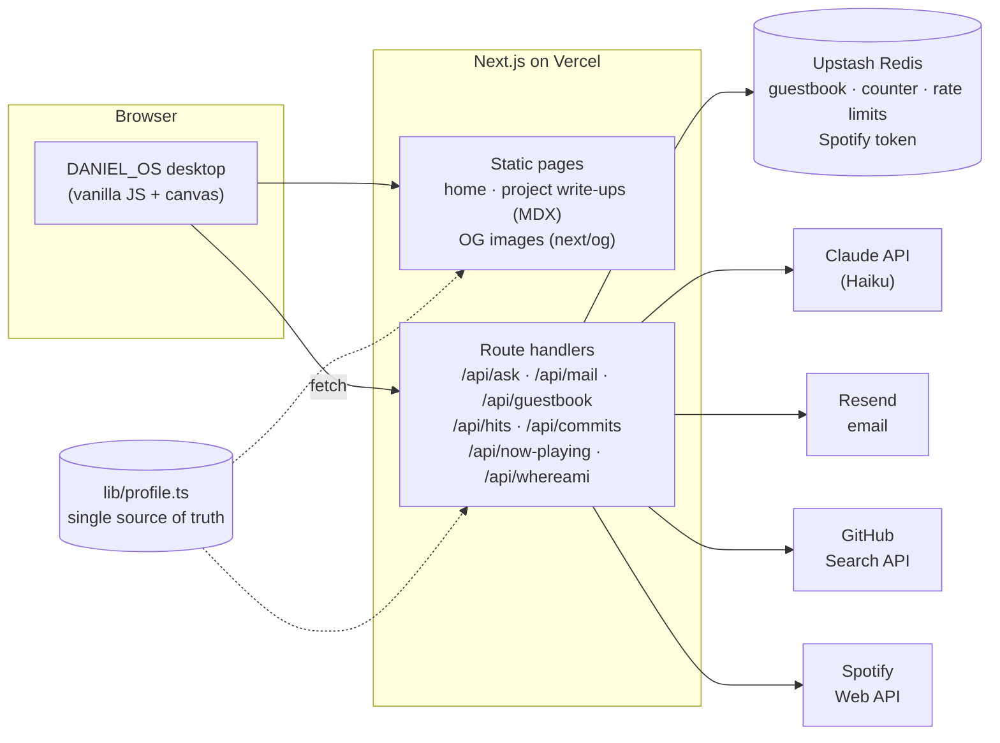
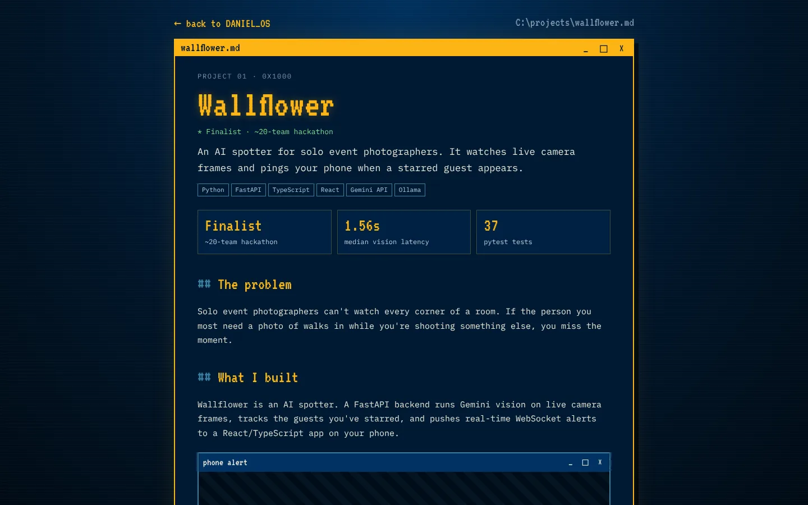
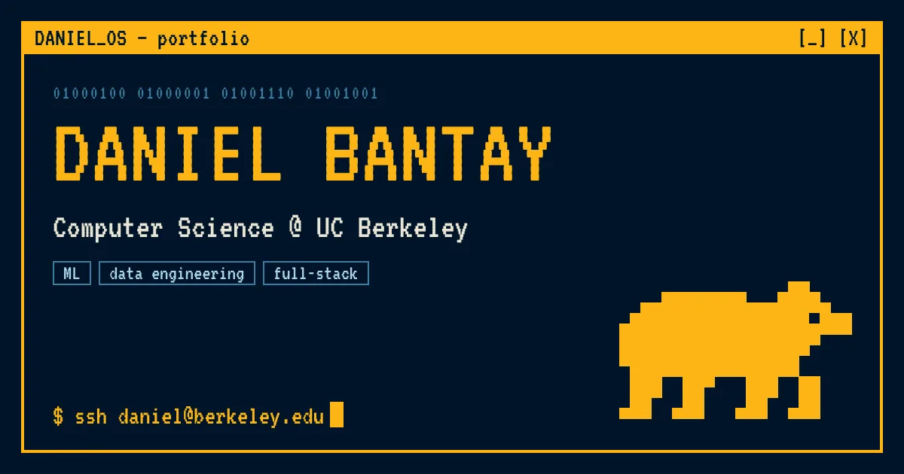
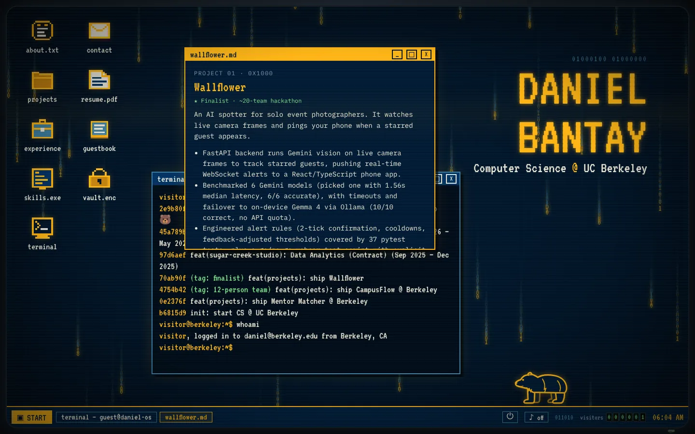

<div align="center">

# DANIEL_OS

**A retro operating system that happens to be my portfolio.**

Boot an isometric pixel-art computer, drag floppy disks into the drive, and explore my work through draggable windows and a real terminal.

**[Live site →](https://YOUR-DOMAIN)** · [Résumé](public/resume.pdf) · [LinkedIn](https://linkedin.com/in/daniel-bantay) · [Email](mailto:dj.bantay@berkeley.edu)



</div>

---

## What it is

Most portfolios are a page you scroll. This one is a small operating system you *use*:

- **Boot sequence.** An isometric pixel-art computer (the "DB-1") sits on a desk. Click the screen, press POWER, type `./power_on.sh`, or drag a floppy into the drive, and the camera zooms into the CRT and boots DANIEL_OS.
- **Desktop.** Projects, experience, skills and contact each open in their own draggable, minimizable window (each with its own accent color), with a taskbar, a Start menu and an idle screensaver. Icons lift on hover and can be dragged anywhere (positions are remembered), windows tilt as you fling them, and project cards tilt toward the cursor. An `fx` toggle (or `clean`) switches to a plain, high-contrast reading mode, which is also the default for visitors with reduced-motion turned on.
- **A working terminal.** `help`, `projects`, `ask`, `mail`, `git log`, `ssh`… plus a few hidden commands.
- **Live data.** A visitor counter, a guestbook, my latest GitHub commits, what I'm listening to on Spotify, and an AI that answers questions about my experience.



## Try these in the terminal

| Command | What happens |
|---|---|
| `ask what did Daniel build at the hackathon?` | Claude answers, grounded only in my résumé data |
| `ssh daniel@berkeley.edu` | a fake SSH handshake, then a remote shell that greets you by name and city |
| `sign <message>` | sign the guestbook (only from inside the ssh session) |
| `git log` | my latest real commits from GitHub |
| `mail` | an interactive mail client that actually emails me |
| `np` | what I'm playing on Spotify right now |
| `whoami` | an animated pixel-portrait ID card |
| `neofetch` | a system-info card, except the system is me (hobbies, dessert spot, twin status) |

<details>
<summary>Spoilers: easter eggs</summary>

The Konami code (8-bit mode with chiptunes), clicking my name 5 times, the Campanile chimes on the hour if sound is on, `weather`, `hack`, `sudo`, `vault.enc` (password hint in the window), and a DVD-style bouncing-logo screensaver after 60 seconds idle.

</details>

## Architecture



**Stack:** Next.js (App Router) · TypeScript · React · MDX · Upstash Redis · Claude API · Resend · Vercel

## Engineering highlights

**One source of truth.** Everything about me lives in [`lib/profile.ts`](lib/profile.ts). The desktop windows, the terminal, the `ask` AI's knowledge, the project pages and the link-preview images all read from it, so updating my résumé updates the whole site at once.

**Pixel art drawn by code, not images.** The DB-1 computer is rendered at startup by a small custom rasterizer: 3D boxes go through a 2:1 isometric projection, polygons are scan-filled pixel by pixel (no anti-aliasing), faces get deterministic dither noise, and a final pass traces the black outline. HTML overlays (the bash screen, LEDs, power button, floppy slot) are positioned with the same projection math and skewed with CSS `matrix()` transforms so they sit flush on each face. See `PC` in [`public/os.js`](public/os.js).

**An AI that can't make things up about me (as far as prompting allows).** `ask` sends the question to Claude Haiku with a system prompt that contains only my profile data and strict rules: answer only from that data, say "I don't know" otherwise, stay on topic, and ignore attempts to override the rules. Input is sanitized and length-capped, the last 3 turns are kept for follow-ups, and cost is bounded by a per-visitor sliding-window limit (8 per 10 minutes) plus a global daily cap. At current Haiku pricing a question costs well under $0.001. See [`app/api/ask/route.ts`](app/api/ask/route.ts).

**Abuse-resistant public endpoints.** Anything visitors can write to (guestbook, mail) is rate-limited per IP with Upstash's sliding-window limiter, stripped of control characters and HTML, length-capped, protected by a hidden honeypot field, and the guestbook rejects links. Terminal output is HTML-escaped everywhere. Owner-only routes (moderation, Spotify setup) are gated by an admin token and return 404 otherwise.

**OAuth done carefully.** Spotify setup uses the authorization-code flow with a random `state` checked against an HttpOnly, Secure cookie (CSRF protection). The refresh token is stored in Redis rather than an env var because Spotify can rotate it on refresh; the code saves the new one automatically. Access tokens are cached in memory until shortly before expiry, and `/api/now-playing` sets a 30-second shared CDN cache, so traffic spikes cost one Spotify call per 30 seconds.

**Works offline, degrades gracefully.** With no API keys at all, the site still runs: storage falls back to an in-memory store, and `ask`/`mail` reply that they're offline and point visitors to my email. `git log` falls back to a résumé-based log if GitHub is unreachable, and the ssh login says "your-browser" when no location is available. Location comes from Vercel's edge geo headers and is never stored.

**Fast and self-contained.** Fonts are self-hosted (no runtime calls to Google Fonts), project pages and link-preview images are prerendered at build time, and GitHub responses are cached for 10 minutes.

## Project write-ups

Each project has its own page written in MDX with custom components (`<Screenshot>`, `<Stats>`, `<Video>`) and its own generated link-preview image.



| Link preview (generated with `next/og`) | Project windows on the desktop |
|---|---|
|  |  |

## How it was tested

Each feature was exercised end to end in a headless browser (Playwright): the boot flow, dragging disks, ssh, signing the guestbook, the `mail` and `ask` flows, and the Spotify widget. External services (Claude, Resend, GitHub, Spotify) were mocked so every success and failure path could be checked, including rate limits, invalid input and services being offline. The Spotify token logic was also checked separately against a stubbed Spotify API: token reuse, refresh-token rotation, and podcast/idle fallbacks.

## Repository layout

```
app/
  page.tsx · os-markup.ts       the DB-1 computer + desktop markup
  api/*/route.ts                ask, mail, guestbook, hits, commits, now-playing, whereami, spotify
  projects/[slug]/              MDX write-up pages + their OG images
public/os.js                    the desktop: window manager, terminal, isometric renderer
lib/                            profile data, Redis store, rate limiting, Spotify, OG card
content/projects/*.mdx          project write-ups
docs/SETUP.md                   run it locally, deploy, configure keys
```

## Run it yourself

```bash
npm install && npm run dev   # http://localhost:3000 (works with no API keys)
```

Deployment, environment variables and maintenance are covered in **[docs/SETUP.md](docs/SETUP.md)**.

---

<div align="center">
Built by <b>Daniel Bantay</b> · CS @ UC Berkeley · <a href="mailto:dj.bantay@berkeley.edu">dj.bantay@berkeley.edu</a>
</div>
